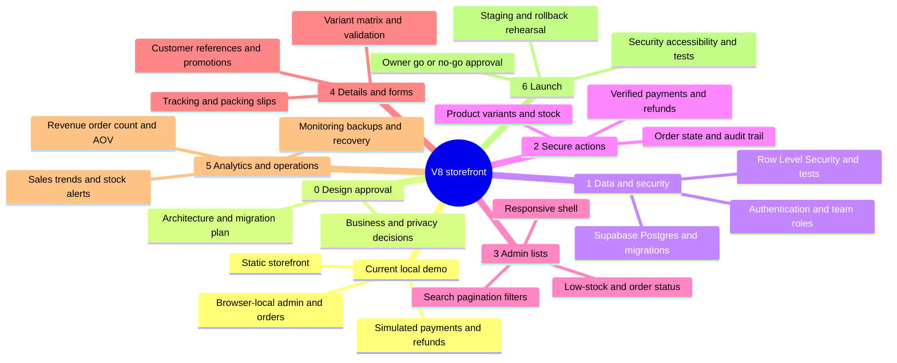

# Storefront roadmap mind map

The current storefront is a browser-local demo. Every future phase below is **not started** and requires owner review; see [ROADMAP.md](ROADMAP.md) for decisions, dependencies and acceptance criteria.

The main dependency path is **design → schema and authorization → secure actions → admin lists → detail forms → analytics → launch**. Some design and operational preparation can happen earlier, but no phase should be treated as approved or complete by default.
